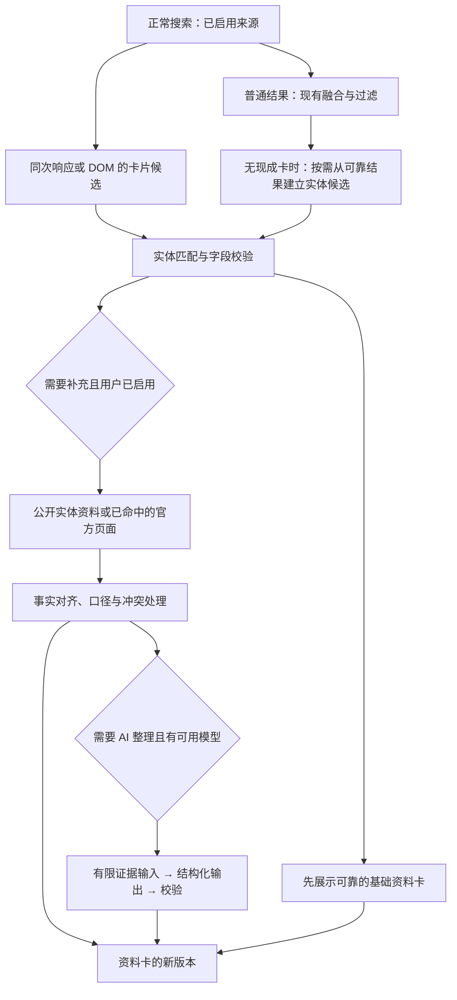

# 右侧资料卡项目策划

状态：策划，尚未实现。调研及代码核对日期：2026-11-13。

## 1. 建议与产品目标

建议建设一套独立于普通结果和 AI 概览的“资料卡”能力：**优先提取当前搜索已经获得的知识卡片，按实体和事实聚合，在需要时用用户自己的模型整理有出处的材料。** 三条路线共用同一数据模型、来源记录和展示组件，按阶段上线。

用户看到的是实体名、简短介绍、关键事实和原始资料入口。Meta 是内部讨论用语，不作为页面标题。它回答“这是什么、有哪些关键属性、去哪里核实”；AI 概览继续回答用户提出的问题、解释和比较资料。

成功不是每次搜索都出现右栏卡片，而是有可靠资料时能快速使用，缺少证据时安静缺席。不开模型、没有 API Key，也应能使用从已启用浏览器引擎提取的基础卡片。

### 首期范围

仅在 `web` 模式处理以单个实体为主要意图的查询：人物、机构、地点、作品、技术概念。第一版每次最多一张主卡，最多 6 个事实字段；先做文字和链接，图片放到来源与授权元数据完整后加入。

不在首期处理实时天气、股价、商家营业状态、跨商家报价、实时事件进展、医疗建议、自动比较表、多个实体的关系图。新闻、购物、学术、图片等模式以后各自设计模板，不能把网页百科卡直接铺到所有标签。

| 查询 | 期望行为 |
|---|---|
| 阿达·洛夫莱斯、清华大学、珠穆朗玛峰 | 有可靠实体材料时显示资料卡 |
| Rust 编程语言、红楼梦小说 | 按限定后的实体显示，不混入同名游戏或电视剧 |
| Rust 生命周期、清华大学怎么申请 | 主要是任务/问题，默认不显示完整百科卡；保留现有概览 |
| 苹果、水星、Transformer、长安 | 证据不能消歧时首期不显示；第二期才提供最多 3 个候选，不由第一个返回的引擎决定 |
| 小米公司 / 小米 SU7 | 组织与车型分开；不混用成立时间、续航等属性 |
| 某公司现任 CEO、某软件最新版本 | 需要日期和时效证据；普通百科缓存不能冒充当前答案 |
| 随机生成的不存在实体名 | 不展示、不让模型补造身份 |

### 推荐默认值

- 基础资料卡开启，只消费用户已启用且本次实际查询的来源。
- 额外公开资料检索默认按需；自动补充由用户设置开启。
- AI 整理默认按需，使用用户已有模型配置；不因开启概览就隐式增加一次模型请求。
- 关闭资料卡后，停止资料卡专用解析、补充请求和模型调用；既有普通搜索照常运行。

## 2. 数据来源调研：哪些可以直接用

下表区分“官方文档确认的能力”和“仍需真实浏览器验证的接入”。官方支持知识卡片，不代表任何查询必定有卡，也不证明 Kiwi 当前选择器可以取到。

| 来源 | 已核实的能力 | 在 Kiwi 中的路线 | 优先级和限制 |
|---|---|---|---|
| Google 搜索 | Knowledge Panel 汇集网页和部分合作数据，面向人物、地点、组织等实体 | 从当前 worker tab 的已渲染卡片提取标题、字段和出处，再用 Kiwi 样式呈现 | P0 采样，首期候选；结构、地区、语言和加载时间需实测 |
| Bing 网页 | 网页实体卡列入采样候选；旧公共 Bing Search APIs 已于 2025-08-11 退役 | 沿用已启用的浏览器来源，验证网页提取 | 不把旧 Bing Entity Search API 列为可用依赖；网页覆盖尚未实测 |
| Brave Search API | Web Search 文档有可选 `infobox`，普通结果有 `extra_snippets` 等结构化信息 | 沿用现有 `brave` 来源与用户 Key，保留本来会丢弃的附加数据 | 首期优先 API 候选；并非每次响应都有 infobox，需真实响应和账号权限验证 |
| Brave 网页 | 现有浏览器来源可作为卡片采样对象 | 可选网页提取器 | 不能假设网页卡片和 API 的覆盖相同；与 Brave API 不算独立事实来源 |
| DuckDuckGo | 官方确认 Instant Answers 来自 Wikipedia 等专门来源 | 优先验证已渲染答案框，保留其原始来源链接 | P0 采样；旧 Instant Answer API 的现行稳定性未确认，不押作首期基础 |
| 百度搜索 / 百科 | 官方有按词条查询的百科 API，返回摘要、基本信息栏等 | 网页卡片先采样；百科 API 作为独立的可选中文增强提供方 | 需要用户自己的 Key/权限，不复用别家 Key；不因为有卡片功能就打开原本关闭的百度来源 |
| Wikidata / Wikipedia | 提供实体与条目数据访问路径；适合作为稳定身份、别名、简述及事实的补充 | 根据已识别实体查询，或按需发现候选；通过 `Env.fetch` 调用 | 第二阶段，独立开关、请求预算、出处及许可记录 |
| 实体官方网站 | 页面可能包含 JSON-LD、明确介绍和资料 | 从已命中的官方页面读取所需字段；结构化数据只当站点的陈述 | 第二阶段按需；`sameAs` 是线索，不能盲目信任任意页面自称的身份关系 |

直接复用应理解为**提取信息和出处**。不保存整块 HTML 到组件，不执行来源脚本，不嵌入对方整页，也不承诺复制地图、视频、评价控件等交互。短描述、图片、标志与数据接口分别保留适用的署名和使用条件；搜索引擎展示某张图，不代表 Kiwi 已取得它的再用授权。

Google 的知识图谱搜索 API 也不等同于搜索页的整张卡片：官方说明它返回匹配实体，并提示不要作为关键生产依赖，所以不是本项目的默认后端。Bing 的后继 grounding 产品同样不等于已退役的实体卡 API。

官方资料：

- [Google：知识面板的来源与含义](https://support.google.com/knowledgepanel/answer/9163198?hl=en)。
- [Google：Knowledge Graph Search API](https://developers.google.com/knowledge-graph)。
- [Microsoft：Bing Search APIs 退役公告](https://learn.microsoft.com/en-us/lifecycle/announcements/bing-search-api-retirement)。
- [DuckDuckGo：搜索与即时答案的来源](https://duckduckgo.com/duckduckgo-help-pages/results/sources)。
- [百度：百科词条详情 API](https://cloud.baidu.com/doc/qianfan-api/s/Pmwbl4slf)；[词条候选查询](https://ai.baidu.com/ai-doc/AppBuilder/ymckc699x)。
- [Google：Organization 结构化数据及 sameAs](https://developers.google.com/search/docs/appearance/structured-data/organization)。

Brave、Wikimedia 的具体文档与接入边界见第 12 节。正式实现前再次核对接口、请求额度和使用条件；本策划没有调用用户的收费接口。

## 3. 三条路线如何组合

| 路线 | 做什么 | 优势 | 主要代价 | 推荐位置 |
|---|---|---|---|---|
| 现有卡片提取 | 同次搜索取出已出现的卡片，统一字段和样式 | 快，无需新增模型，有现成实体线索 | DOM 易变，覆盖受上游限制，卡片可能晚于列表加载 | 首期核心 |
| 多源聚合与补充 | 同实体的材料对齐，补字段，保留冲突；可查公开知识库 | 字段更完整，可以清楚记录出处 | 实体消歧、字段口径、来源依赖与时效处理 | 基础合并首期，完整增强第二期 |
| 有证据的模型整理 | 从普通结果材料新建资料卡，或整理已有卡：映射模板、压缩/翻译，辅助消歧 | 适应别家没有卡的实体及非结构化材料 | 增加延迟/成本，必须校验事实与引用 | 第三期，默认按需 |

运行顺序：



其中任何一条卡片支线失败，都不阻止普通结果和已有概览完成。基础卡没有缺口时不为了“更智能”多做一次生成。

**别的引擎没有卡片，也可以生成。** 第三期允许从普通结果中已经取得的可靠材料建立实体候选，用户选择“整理资料”后进入同一证据处理流程。有现成卡并非生成的前提；有可核对的身份和材料才是前提。若连身份或材料也不确定，仍不生成。

## 4. 页面设计与交互

### 与现有右栏共存

当前 `App.tsx` 已有 `.rail` 放置 AI 概览；宽度达到 `76rem` 时，布局为 `42rem` 结果列、`2rem` 间隔、`22–30rem` 右栏。保留结果列宽度和与搜索框的对齐，不另开第三栏。

宽屏实体查询的顺序：

```text
Kiwi    搜索框
        模式标签
        状态
        ┌─ 普通结果列 ───────────┐   ┌─ 资料卡 ─────────────┐
        │ 结果 1                 │   │ 实体名称 / 类别       │
        │ 结果 2                 │   │ 一句话介绍            │
        │ 结果 3                 │   │ 4–6 项关键事实        │
        │ ……                    │   │ 官网 / 资料来源        │
        └───────────────────────┘   └─────────────────────┘
                                    ┌─ AI 概览 ───────────┐
                                    │ 对当前问题的解释与引用 │
                                    └─────────────────────┘
```

这只是布局线框，不是把结果改成有边框卡片。结果仍保持现在的纯文字排版，资料卡使用中性底色与发丝线，现有绿色概览保留自己的层级。默认以实体名称作标题，无需再重复一行“Meta 信息”。

当前整个 `.rail` 吸顶，而 Overview 具有一屏高的内部滚动。加入第二块内容后不能直接沿用：首期在有资料卡时采用普通页面滚动，取消这组重复滚动约束；只有概览时维持已有行为。之后如需吸顶，仅在整个右栏实际能装入可视高度时启用。

窄屏沿用一份 DOM：资料卡 → 概览 → 结果。资料卡先展示实体名、短描述和 2 个核心字段，其他内容通过“展开资料”展开；概览继续使用原有折叠规则。不给图片设置大幅首屏封面。缩放到 200% 时按实际宽度自然回到窄屏布局。

### 卡片内容

| 类型 | 优先字段示例 | 暂缓字段 |
|---|---|---|
| 人物 | 身份、出生日期/地点、主要作品、官网 | 缺乏来源的关系、争议标签及推测性个人资料 |
| 机构 | 机构类型、成立时间、总部、官网 | 无时点的现任管理者、实时规模/市值 |
| 地点 | 地理类型、所属区域、坐标/海拔（含单位） | 无统计年份的人口、营业状态、导航 |
| 作品 | 作者/导演、作品类型、首发时间、原始条目 | 不同平台的评分直接混合、不同改编版本混用 |
| 技术概念/软件项目 | 简短定义、领域/类型、官方文档、已核验的项目链接 | 未核验的“最新版本”、从记忆补写的参数 |

没有的字段直接省略，不填一排“未知”。至少要求身份、一个有效来源入口，以及短介绍或至少一个有用事实；只有标题的空壳不显示。显示最多 6 个优先事实，不把所有抽到的字段堆出来。

引擎仍只用真实品牌小图标表示提取渠道；每项事实可点开原始资料。来源详情按“事实来源 → 由哪个引擎取得 → 获取时间”说明，不显示虚假的可信度百分比。不能把“两个引擎收录”写成“事实已被两家验证”。

卡片引用使用独立的稳定证据 ID 和出处入口，不抢占 Overview 的 `[n]` 编号。官网按钮必须来自可验证字段，不由模型拼接 URL。

### 加载和状态

- `idle`：没有候选，完全不占位。
- `collecting`：已经有实体候选、仍在收集；只呈现短暂且有结束时间的局部状态。
- `ready`：有可用卡片，立即展示；不等所有引擎。
- `ambiguous`：候选无法可靠归一，P1 不显示主卡；P2 才增加有限的实体选择。
- `refreshing`：用户要求补充/刷新时保留旧卡，标明正在更新。
- `unavailable`：自动提取失败时静默收起；用户明确点了补充后失败，局部说明并可重试。

实体身份一旦展示就固定；晚到材料可以补充该实体的字段，不能突然把“苹果公司”换成水果。已显示字段遇到实质冲突时撤下该字段或展示“资料有差异”，不能静默覆盖。用户选定的实体、展开状态和打开的引用不会被后续快照重置。

为了防止晚到卡片把正在阅读的概览推走：卡片首次出现前若右栏已有用户交互或用户已滚离顶部，将其作为“查看资料”入口呈现，待用户打开；无交互时允许插入，但使用稳定尺寸和滚动位置策略。移动端不在读者已经开始阅读后自动插入大块内容。

## 5. 数据模型：以实体和事实为单位

普通 `SearchHit` 表示一条搜索结果。资料卡是查询级的独立产物，不作为伪造的 `SearchHit` 加进 RRF，不占结果数量，不参与普通 URL 排名，也不自动成为概览引用。

建议设计以下对象；命名是开发提案，并非当前已经存在的类型：

| 对象 | 必需内容 |
|---|---|
| `KnowledgeCandidate` | 提取渠道、提取时间、实体名/类型、语言、实体标识线索、原始字段及证据 |
| `EntityIdentity` | 本次选定身份、稳定实体 ID（如有）、规范 URL、别名、用于区分的属性 |
| `Evidence` | 稳定 ID、原始 URL、展示/提取渠道、内容类型、支持片段、抓取时间、资料日期/时间精度、共同上游线索 |
| `Fact` | 标准属性、类型化的值、显示文本、单位、限定条件、时点、证据 ID、冲突候选、提取或生成标记 |
| `KnowledgeCard` | 实体身份、描述、已接受事实、出处、可选图片与署名、版本、完整/部分状态 |

`retrievedAt` 只表示我们取得资料的时间，不能变成资料发表时间、事实生效时间或“最新”。日期保留日/月/年的精度；没有时区的日期不能因转换显示成前一天。

### 实体匹配

1. 优先使用经验证的同一知识库 ID、相同规范条目 URL，或其他领域标识，如论文 DOI。
2. 其次使用明确的跨条目链接、别名、实体类别和区分属性；组织官网域名只是辅助信号，不能把同站人物、子公司或产品全并成一项。
3. 名称相同不是合并依据；同名人、同名作品、公司与产品、城市与省份必须能分开。
4. 只有标题字符串、且缺少区分证据时，保留候选，不自动混合事实。
5. 中英文、简繁别名可以对齐，但要建立在身份相同的证据上。不能因为文本翻译相似就认成同一实体。

首期采用规则与可解释身份线索；如引入模型消歧，模型只能从输入候选中选，并允许“不确定”。模型自报的信心不是校准过的概率。

### 字段归一和冲突

- “成立日期 / Founded”可映射到相同属性；“创办日期 / 注册日期”未必是同一属性。
- “市区人口 / 都市圈人口”或者不同统计年份不是可投票的冲突，保留口径和日期。
- 单位和日期标准化后才比较值；事实值必须保留原文以便解释转换。
- 完全相同的事实合并证据；不同值按字段适用性、原始来源、日期及口径处理，不能求平均，也不能简单按引擎数量选票最多的值。
- 官网适合确认机构自己的名称、地址和产品定义，但自述宣传不自动变成中立事实；不存在覆盖所有领域的统一“来源分数”。
- Google、Bing、DDG 都引自同一百科条目时按一个已知根源记录。找不到共同上游不等于已证明互相独立。
- 无原始链接的引擎卡字段可以保留“引擎页面所示”的证据等级，并链接搜索页；不能伪装成直接引用原始出版物，不自动升级为强事实。

卡片遵守用户的域名屏蔽与相关自定义规则，不因为藏在卡片里就绕过它们。已知原始来源被屏蔽时，不经搜索引擎包装后重新展示；未知原始来源仍标为未知，不能宣称它通过了原始站点检查。模型生成只消费通过相应过滤的材料。

## 6. 对现有架构的具体改动

### 当前代码核对结果

- `BrowserEngine.extract`、`Env.runBrowserEngine`、`SearchSource.search`、`SourceCache` 都围绕 `SearchHit[]`，尚无查询级资料卡通道。
- `engines.content.ts` 拿够普通结果会结束并停止 DOM 观察；`tabRenderer.ts` 收到结果会清理请求。后来出现的右侧卡片可能被漏掉。
- 页面有 6 秒软截止；卡片不能延长普通结果或概览的等待。现有晚到结果的合并时机还受 `done` 影响，不适合直接当作卡片更新通道。
- 页面 reducer、后台 keepalive 和 MCP 都需要认识新状态，不能只增加一个 React 组件。
- MCP bridge 在 `runSearch` 返回后会 abort，MCP server 又显式组装返回字段，所以新增卡片不会自动透传。

### 推荐接口边界

保留所有引擎现有的 `extract()`，新增可选 `extractKnowledge()`，在同一 DOM 快照上调用。浏览器响应升级为 `{ hits, knowledgeCandidates }`。来源层逐步引入统一 envelope；旧 API 来源暂时仍可返回数组，使用唯一的 `normalizeSourceResponse()` 实现兼容转换，避免一次重写所有解析器。

归一化不能只覆盖 pipeline：`academic.ts` 的 Crossref 核心论文核验和学术计划二轮检索也直接调用 `SearchSource.search()`，随后使用数组操作。应在所有调用者之前的公共 wrapper 统一归一，或让这些调用点使用同一个 helper；必须盘点全部直接消费者并做学术回归。

搜索结果和资料卡的分支共享采集，但后续逻辑独立：`resolveEntity` → `normalizeFacts` → `mergeFacts` → `buildKnowledgeCard` 都放在 core，纯逻辑不调用 `browser.*`；网络仅经 `Env.fetch`，浏览器工作由 extension 承担。

建议新增 `knowledge_update` 事件，包含查询运行 ID、revision、完整卡片快照及状态；`PipelineResult.knowledge?` 保存完成时快照。reducer 只接受本次运行和更新的版本，`done` 不能把较新的卡片状态覆盖成旧快照。没有资料卡的来源和旧数据结构仍能正常完成搜索。

首期不让资料卡额外延长 `runSearch`。普通来源返回时同步接受已提取的候选；后续来源在已有晚到生命周期内可提交独立更新，不等概览生成。后续阶段若允许卡片专用补充任务在 `done` 之后运行，必须显式记录 `knowledgePending/settled`、结束时间与取消句柄，并纳入端口和后台存活管理。

### 迟到 DOM 的两种方案

**首期选同快照提取。** 只读普通结果交付时已经出现的卡片，接受覆盖率不完整。P0 要测出它的漏采比例，作为是否投入二阶段协议的依据。

**后续按证据决定是否做有限双阶段协议。** 普通结果先交付，worker 在无排队冲突时继续观察短时间，卡片到达后发送独立事件。候选观察上限可从 0.5–1.5 秒实验；这是待测参数，不是为每次搜索固定增加等待。需要下一任务复用 worker 时优先新任务，放弃旧卡片补采。必须有 request ID / navigation ID、明确关闭信号、取消与超时清理。

没有采到卡片、验证码或来源失败，不触发自动绕过、不为追卡片再启动同源搜索，也不把 worker 窗口自动抬到前台。

### 文件改动地图

| 范围 | 预计文件/模块 | 要解决的事 |
|---|---|---|
| 核心契约 | `packages/core/src/types.ts`、`index.ts` | 候选、证据、事实、卡片、envelope、事件、结果快照 |
| 采集 | `engines/shared.ts`、选中的引擎、`sources/brave.ts` | 可选卡片提取器、真实字段解析、API 附加对象 |
| 纯逻辑 | 新 `packages/core/src/knowledge/` | 身份归一、字段映射、冲突、过滤与卡片选择 |
| 管线/缓存 | `pipeline.ts`、`cache.ts` | 独立更新、取消、完成语义、cache schema |
| 其他来源消费者 | `academic.ts` 及全部直接 `source.search()` 调用点 | 统一响应归一，保留核心论文核验和学术二轮检索 |
| 浏览器协议 | `lib/messages.ts`、`engines.content.ts`、`lib/tabRenderer.ts`、`background.ts` | 跨上下文传输，必要时双阶段生命周期 |
| 页面状态 | `lib/searchState.ts`、`lib/useSearchSession.ts` | 版本、清空、晚到、端口、补充动作 |
| 页面组件 | 新 `KnowledgeCard.tsx`、`App.tsx`、`style.css` | 共享 rail、资料来源、折叠、无卡状态 |
| 配置/文案 | `config.ts`、options、i18n catalogs | 默认值、按需增强、隐私说明和多语言 |
| MCP | `apps/extension/lib/bridge.ts`、`packages/mcp/src/server.ts` | 可选 knowledge snapshot，明确部分状态 |
| 文档 | `DESIGN.md`、对应 internals、`STATUS.md` | 最终行为、真实验证与未验证边界 |

新标签页只使用 core 的类型导入，不把知识提取器或其他 core 运行时代码打进页面。界面文案放 catalogs，经 `t()` 获取；新字段采用配置默认合并，只有需要重写旧数据时才加 migration。

### MCP 的发布约定

MVP 增加可选 `knowledge` 快照，不改变现有 `results`、`summary`、`citations` 含义。返回 `complete/partial` 和资料时间，不能把尚未采完包装成完整知识。

`search` 默认不增加额外模型请求，不为了等资料卡延迟响应。后续可选参数再决定是否补充，以及可接受的预算；接口返回后立即取消未完成的卡片专用任务，不在后台无界生成。Chrome 内置模型仅在支持的页面上下文可用，MCP 不假装能调用它。

## 7. 大模型生成的具体边界

“生成资料卡”指把已有证据整理成卡片。模型记忆可以提出内部检索线索，但不得直接作为展示事实或 URL 的来源。

支持两种入口：已有卡片的“补充资料”；没有现成卡，但可见搜索结果已包含明确实体及可靠材料时，在概览操作区提供“整理资料”。后一种路径先确认实体身份，再选择证据并创建卡片；自动模式只有用户启用后才运行同一流程。没有材料时不显示一个诱导模型补造的空卡入口。此入口和从普通结果建立候选的逻辑属于 P3，不增加到 P1。

建议先做最窄的能力：给定实体身份和 3–5 个已通过过滤的材料片段，生成一段短描述、选择最多 6 项有证据的字段。输入包含证据 ID、类型、时间和原文；输出是受 schema 限制的 JSON，不是 HTML，也不是可自由扩展的 Markdown。

输出必须经过：

1. JSON schema、字段白名单、长度、数量及类型检查。
2. 只能引用本次输入已有的证据 ID；链接从证据表回填，拒绝模型自造 URL。
3. 核对每项值确实受引用片段支持。引用存在不等于事实被支持；日期、数字、名称尤其需要确定性核对。无法自动核实的释义仅作带引用的简述，不能升格为精确属性。
4. 身份和时间检查：不能换实体、去掉限定词，或把过去状态说成当前。
5. 任何非法/不确定字段丢弃；无有效输出时保留已有提取卡，不展示半截 JSON。

从页面抓到的内容和模型回复都是数据，不是指令。沿用并核对现有内容注入检测、材料隔离和取消流程；不能因为使用 JSON 模式就视为安全。新卡片逻辑不赋予模型浏览器控制或任意 URL 请求能力。

不逐 token 展示事实。基础卡先显示，模型结果完整校验后一次提交新版本。每个实体和证据版本最多自动整理一次；晚到材料不触发连续重生成。用户明确点击补充才允许另一次生成。

初始实验预算：每次最多 1 个模型请求、约 3,000 输入 token / 800 输出 token、约 5 秒独立超时；均是待测上限，实际分词与供应商计费分别记录。专有名词、数字与证据引用不随翻译改变；资料内容语言沿用现有概览语言选择，字段标签使用界面语言。第一版生成只支持已配置的 API 模型，内置模型另行验证能力和语言，不扩展未经验证的支持声明。

## 8. 成本、缓存、隐私与失败降级

### 请求预算

| 路径 | 首期新增请求 | 后续预算建议 |
|---|---|---|
| 同次 SERP / API 卡片 | 0 次额外搜索、0 次模型调用 | 仅解析附加信息；不承诺零 CPU 或零额外响应字节 |
| 外部实体增强 | 首期不自动运行 | 每次最多 2–3 个请求、并发 2、独立超时，429 按服务要求退避 |
| AI 整理 | 首期不运行 | 每次 1 个请求，输入/输出与取消均有上限 |
| 图片 | 首期文本卡不加载图片 | 最多 1 张主图，懒加载，独立失败与缓存 |

基础路线的“零额外搜索请求”不等于加载外链图片没有网络请求。图片阶段要单独说明哪些主机会收到请求，采用无 cookie、无 Referer 的可控获取方式，限制类型和大小，沿用公开地址检查并处理重定向；图片失败就省略图片，不使用模型生成的肖像冒充真实实体照片。

每次搜索的增量成本按 `新增数据请求费用 + 输入 token × 输入单价 + 输出 token × 输出单价` 计算。P0/P3 用用户选定服务的实际价格测算；本计划不预设免费、固定费率或所有账号有同等额度。

### 缓存

首期将候选与普通结果一起缓存，保留原抓取时间，继续采用网页来源短 TTL（当前默认 5 分钟），避免先建设长期实体数据库。即使只有卡片没有普通结果，也可以缓存有效 envelope；明确区分无卡、解析失败和请求失败，失败不当作长期“该实体不存在”。

cache key 需要版本化，并包含相关 mode、query、source、locale 及解析策略；卡片候选不能跨查询限定条件或语言误用。当前 lowercase query 规则是否适合大小写敏感技术实体要用测试决定，不能直接扩大复用范围。

如果以后增加合并卡缓存，key 还需包含实体 ID、证据 hash、策略版本、输出语言、启用来源/过滤规则指纹；生成文本再包含模型与 prompt 版本。用户关闭来源或改变屏蔽规则后，旧聚合缓存不能把相应事实带回来。`refresh` 同时绕过相关结果、候选和生成缓存，但仍尊重速率限制。

### 失败优先级

完整增强卡 → 已有提取卡 → 只有可靠的有限字段 → 不显示。补充来源不可用时不影响主搜索；AI 超时/格式失败时不重试到耗尽用户额度。可记录本地原因和阶段耗时，不自动上传查询、片段或统计。

公开知识库无需 Key 也仍会收到查询/实体请求及网络信息，应在设置里说明。是否自动请求与是否显示现有卡片分开控制。用户已经关闭的来源、模型或图片权限不被功能兜底重新启用。

## 9. 实施阶段、交付与工作量

以下为一名熟悉仓库的工程师投入估算，不是承诺交付日；包含开发和必要验证，不包含上游账号审批、长时间风控等待。P0 后重新估算。

| 阶段 | 工作 | 交付/退出标准 | 估算 |
|---|---|---|---|
| P0 真实可行性探针 | 代表查询采样；对比 Google/Bing/DDG/Brave/百度；查看当前用户可用 API 的文档与后续授权测试条件；记录 DOM 时序 | 选出 1 个无 Key 浏览器首发来源和可选 Brave API；真实脱敏 fixture；卡片覆盖/漏采/字段表 | 2–3 人日 |
| P1 可用首版 | 独立数据通道、1 个浏览器提取器、可选 Brave API、保守同身份合并、文字卡、来源、UI/缓存/MCP 快照 | 无模型可用；无卡不占位；不阻塞结果；真实 Chromium 激活与数据保留验证 | 5–8 人日 |
| P2 完整聚合 | 第二个浏览器来源、身份候选选择、口径/冲突、可选 Wikidata/Wikipedia 补充、图片署名 | 不混实体、不伪造独立验证；禁用来源和过滤变更立即生效；按需增强闭环 | 4–7 人日 |
| P3 证据内生成 | 无现成卡时从结果创建候选、schema、证据校验、语言、预算、取消、失败降级、质量评测 | 关闭时零相关模型调用；无证据不填；生成比确定性模板确有增益 | 3–5 人日 |
| P4 可选扩展 | DOM 二阶段采集、学术作者/论文、作品专用卡、动态数据接口 | 每种模板有独立时效、来源与验证标准 | P0/P2 数据出来后另估 |

首个可用版本为 P0 + P1，约 **7–11 人日**；完整基础增强为 P0–P3，约 **14–23 人日**。多个适配器、UI 和纯逻辑测试可以并行，但先冻结身份/证据/envelope 契约，浏览器协议和生命周期由同一负责人整合，避免并行改坏消息格式。

P0 如果发现无需 Key 的浏览器卡片在最小化 worker 中经常不出现，就减少首发来源、重新评估观察窗口或把公开知识库增强前置；不能靠等待更久或只演示几个名人查询掩盖覆盖不足。首期不把“接了五家”当验收条件。

每个阶段独立可关闭、可回滚。保留原始提取资料与可复现输入，解析器改坏时可以仅关单个卡片适配器，而非关掉该引擎的普通搜索。

## 10. 验收计划

### 固定查询集

建立 60 条中英文查询，P0 冻结分组与预期，再用真实响应标注事实；不凭模型记忆制作正确答案。建议：24 条明确实体（五类均覆盖）、10 条同名歧义、8 条任务/问句、6 条相近身份/不同版本、4 条跨语言别名、4 条时效/日期限定、4 条虚构或无资料。

额外使用合成输入测试攻击片段、无效 URL、伪造出处、畸形 JSON、超大字段等，夹具首行注明手写。真实 HTML/JSON 记录采集日期、语言、是否登录及场景，移除 cookie、查询令牌和个人化内容。浏览器默认/用户实际语种与至少另一种语言分别取样，不把某一地区的结果当全局覆盖。

### 必须覆盖的行为

| 范围 | 重点案例 |
|---|---|
| 提取 | 有/无卡、多个实体、广告或相关推荐误入、隐藏 DOM、零普通结果有卡、字段缺失、上游结构变化 |
| 身份/事实 | 同名不同实体、别名同实体、不同年份/统计范围、同百科被多个引擎引用、来源未知、冲突不覆盖 |
| 生命周期 | 换查询、切模式、Back、刷新、abort、端口断开、晚到、验证码后继续、worker 被新查询复用 |
| 缓存/设置 | 命中保留原时间、刷新绕过、schema 升级、关闭来源/模型、改语言、改屏蔽规则 |
| AI | 引用存在但不支持事实、编造 URL、改数字、换身份、提示注入、拒绝/超时/无效 JSON、只允许一次调用 |
| UI | 360/768/1280/1920px，200% 缩放，明暗主题，键盘/读屏，长中英文，图片失败，长概览滚动 |
| MCP | 原字段不变，可选快照，部分状态明确，完成后取消专用任务，默认不额外生成 |
| 现有功能回归 | 学术核心论文的 Crossref 核验、学术计划二轮检索；来源响应升级不能破坏直接消费者 |

### 发布门槛

- 固定验收集的已展示卡片 **0 个实体混合、0 个无依据新增事实**；这是该验收集的门槛，不等于现实世界错误率为零。
- 已展示事实 **100% 有可打开的证据入口**，明确区分原始材料与仅搜索页可见的转述。
- 无须等待卡片即可交付首批普通结果；在固定回放环境比较前后，首批结果增量 P95 目标不超过 100ms。真实网络延迟另外记录，不把上游波动算成本地算法效果。
- 关闭补充/生成时专用网络和模型调用为 0；关闭资料卡时不会残留旧卡。
- 卡片相关错误不造成整页 fatal、概览引用变化或原结果数量变化。
- 新旧查询与导航彻底隔离；同一证据版本不会无限生成或无限重试。
- 亮暗主题与窄屏无溢出，引用和折叠可用键盘操作，长右栏可完整访问。

覆盖率作为 P0/P1 实测指标单列：`显示有效卡片的明确实体查询数 / 全部明确实体查询数`；另报 `当前时刻成功解析数 / 上游实际出现卡片数`，区分上游无卡和 Kiwi 漏采。P0 必须冻结首发支持类别、查询集和 P1 最低有效卡片数，建议以支持集覆盖率至少 60% 起评，并按类别列出分子/分母；P0 数据不足时先调整来源或首发范围，不能在 P1 验收时挑删失败查询。未达到门槛则不能宣称该范围已可用，也不能用空卡规避验收。覆盖率不能放松错误实体和无证据字段的门槛；小样本结果不代表全网覆盖率。

### 实施阶段验证与发布

运行 core、extension、MCP 各自测试及 `pnpm typecheck`、所需构建。根级 `pnpm test` 的 experiments 空包问题按当时仓库状态说明，不拿已知无关失败掩盖新问题。

最终必须按 [真实浏览器验证规则](internals/testing.md) 更新用户原 Chromium profile、原扩展路径和 ID：在仓库外备份设置和旧构建，验证实际执行代码、完整 manifest、UI 及配置/Key/配对数据保留。不得卸载、替换 profile 或用测试配置覆盖用户设置。记录哪些来源、语言、登录状态和卡片实测过，哪些没有。

## 11. 推荐直接采用的决定

1. 用户界面称资料卡，以实体名为标题；内部能力称 `knowledge`，避免与网页 `<meta>` 标签混淆。
2. 首期仅 web、单实体、文字与链接、最多 6 个字段，和 AI 概览共用右栏。
3. 优先同次采集，无 Key 浏览器路径必须可用；Brave API 是已有 Key 用户的增强。
4. 一开始就记录字段级出处和时间；不先做整卡拷贝再补来源模型。
5. 先身份归一，再事实合并；不按引擎数量给事实投票。
6. 额外资料和 AI 默认按需；有证据才生成，没有证据就缺席。
7. 先 P0 + P1，P2/P3 用覆盖率和质量结果决定投入；动态数据卡单独立项。

## 12. 调研与验证记录

补充官方接口与内容来源：

- [Brave Web Search API 参考](https://api-dashboard.search.brave.com/api-reference/web/search/get)：可选 `infobox`、网页结果及附加结构化字段。接入时为所有非必需字段留空值路径，`schemas` 不自动升级为已核实事实。
- [Brave rich results 流程](https://api-dashboard.search.brave.com/app/documentation/web-search/get-started)：天气、体育等 rich 结果使用 callback 再请求，和同次响应中的实体 infobox 分开规划；首期不启用这条额外请求路线。
- [Wikidata 数据访问](https://www.wikidata.org/wiki/Wikidata:Data_access)：实体访问方式与结构化数据的 CC0 条件。优先读取明确实体，保留声明的限定词、日期、引用和 rank；不把每次搜索变成复杂的全库 SPARQL 查询。
- [Wikipedia Page Content Service](https://www.mediawiki.org/wiki/Page_Content_Service)：条目摘要、描述和缩略图等能力。正式接入前验证当前端点、跨域、限流和用户网络可达性；摘要与结构化事实分别处理。
- [Commons 内容复用说明](https://commons.wikimedia.org/wiki/Commons:Reusing_content_outside_Wikimedia)：图片的使用条件取决于各文件。图片元数据须保存原文件页、作者、许可和许可链接，Wikidata 数据的 CC0 不代表所链接照片也是 CC0。Wikipedia 文本也按其自身许可处理，不能继承 Wikidata 的许可。
- [DuckDuckGo Instant Answers](https://duckduckgo.com/duckduckgo-help-pages/features/instant-answers-and-other-features)：用于确认功能类别，不能据此推定某个旧 API 的可用范围。

百度官方目录另列“阿拉丁卡结构化信息（beta）”，但本次正文读取超时；仅保留为 P0 调研线索，不写入已确认能力或首期交付。百科详情接口的 `card` 内部项形状仍需真实响应验证，不能只凭字段名编造解析器。

2026-11-13 已完成：阅读仓库新标签页、管线、来源、决策模型、概览、配置、测试及设计文档；只读核对实际类型、内容脚本终止时机、缓存、reducer、MCP 返回路径和右栏 CSS；查阅上述官方在线资料，并形成分期策划。

本次没有实现资料卡，没有运行新的提取器、调用用户 Key、采集真实 SERP 卡片、修改浏览器设置或加载新扩展；没有测量覆盖率、性能或模型质量。接口能力的文档核实不等于用户账号可用，也不等于网页 DOM 路线已经跑通。

仓库在本次调研期间已有多项未提交的其他工作；计划以实际文件为准，不将入口说明中的模式/来源总数当作不变前提。后续开始开发先确认当时基线，并把最终英文实现与实测记录写入 `docs/internals/knowledge-cards.md`，再补 AGENTS 索引，更新相关 topic 和中文 `STATUS.md`。当前这份中文策划是本项目的唯一计划正文。
