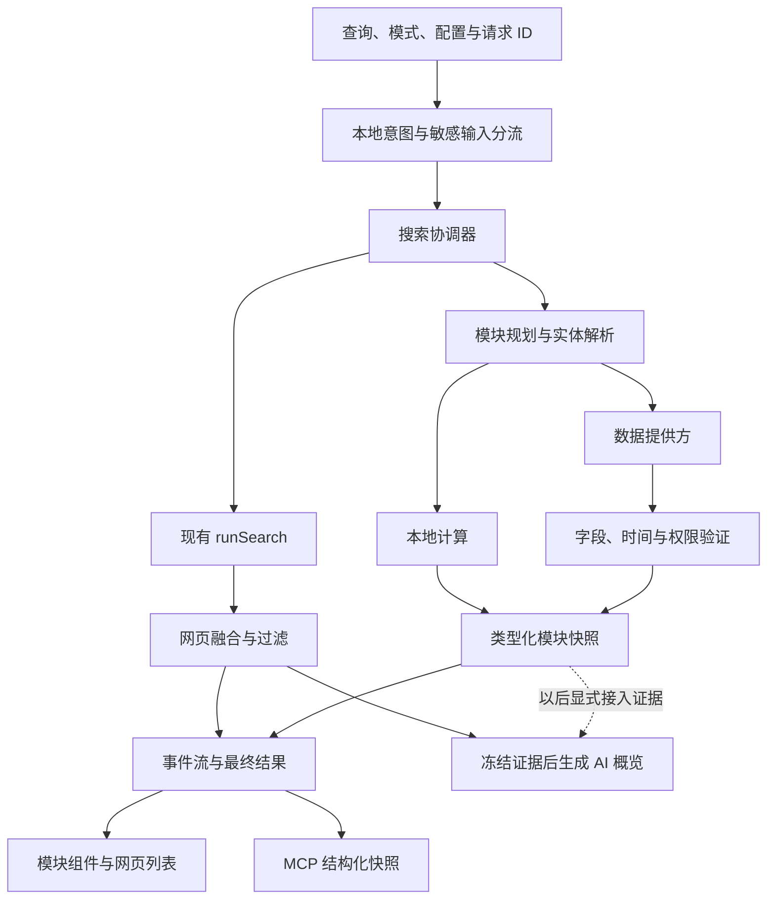

# Kiwi Search 搜索模块完整策划

日期：2026-11-13。状态：策划与资料核对，尚未实施。

目标：把其他搜索引擎中有价值的直接答案、工具、实体信息和垂直服务，逐类纳入 Kiwi，以自己的组件展示。天气与股票是首批业务样板，整体范围包括生活、出行、体育、知识、娱乐、购物、教育等。股票同时规划 A 股、港股、美股，按各市场的数据可用性分批交付。

本文基于当前工作区代码、官方产品帮助和数据接口文档。竞品功能会随地区、设备、登录状态和实验变化；官方文档也可能保留已经停用的功能。因此，本文建立可持续补充的覆盖台账，不把文档检索说成所有竞品的全量现场验收，也不把未来目标记作已支持。

关联文档：[现状](STATUS.md)、[前端改进计划](FRONTEND-PLAN.md)、[现行设计规范](../DESIGN.md)、[管线](internals/pipeline.md)、[新标签页](internals/newtab-page.md)。本文的模块展示、署名与状态规则是拟议的设计扩展；实施时再同步现行规范。

## 1. 产品方向与完成口径

### 1.1 用户得到什么

- 搜“杭州明天下雨吗”，直接查看明确地点、日期、降水概率和逐小时预报。
- 搜“腾讯股价”，先确定港股证券，再看到币种、行情时间、交易状态和走势。
- 搜“100 美元人民币”，得到可修改金额的换算工具，并能看见汇率日期。
- 搜“皇马下一场”，得到赛事卡；搜“北京到上海”，可选择航班、火车或路线。
- 搜电影、菜谱、附近商店、快递、节假日等，得到适合任务的组件；普通搜索结果继续保留。

模块始终回答当前查询。空白新标签页保持现有首页；不因模块增多而自动加载天气、行情、资讯和推荐流。

### 1.2 四种能力分开管理

| 能力 | 例子 | Kiwi 中的位置 |
|---|---|---|
| 确定性工具 | 计算器、单位换算、时间计算 | 本地执行，固定组件，无需 AI 或搜索来源 |
| 结构化数据模块 | 天气、股票、比分、航班状态 | 实体识别 → 数据适配器 → 验证 → 固定组件 |
| 内容与实体模块 | 人物、电影、菜谱、地点、商品对比 | 有来源的字段和内容列表，可逐步增强 |
| AI 解释与综合 | 原因解释、比较、行程建议 | 使用固定证据快照生成，明确标为 AI 内容 |

搜索模式、单条网页的富摘要、模块、AI 回答是不同概念。保留已有十种模式；无需为每一个天气、计算或球队查询再增加顶层标签。新闻、购物、学术已有的能力继续复用。

### 1.3 什么才算“支持”

每项分别记录四个维度，不能用一个勾掩盖缺口：

1. **交互**：能否识别查询、消歧、显示自己的组件并完成核心操作。
2. **数据**：覆盖哪些地区、市场、语言、实体和字段，数据有什么时效。
3. **接入**：无需 Key、用户 Key、用户浏览器会话，还是尚缺可用提供方。
4. **验证**：仅文档、模拟数据、真实接口、原 Chromium 实测分别记录。

台账状态统一为：`规划中 → 数据验证中 → 开发中 → 可用（限定范围） → 已验收`；暂不可接入的维持“缺少数据来源/权限”，不中途从范围中删掉。普通网页链接、跳转原站或只有组件外壳，均不算该模块完成。

## 2. 竞品研究与证据边界

### 2.1 调研框架

对照 Google、Bing、DuckDuckGo、Brave、百度、搜狗、Yandex。按用户任务归并同类能力，避免把同一个天气卡的不同布局当成不同模块。

证据分为：**D** 官方产品说明；**A** 官方 API 可提供的数据；**R** 发布者可标记的富结果类型；**H** 官方历史资料；**V** 当前真实结果页观察。R 不代表一定出现独立互动组件；A 不代表用户当前套餐可访问；H 不代表当前仍上线。本次模块调研没有逐项取得 V 级证据。

| 产品/资料 | 已确认的范围 | 对 Kiwi 的启发与限制 |
|---|---|---|
| Google 产品帮助（D） | 计算/函数图/单位/颜色、天气、体育、知识面板；旅行、影视、招聘、健康与个人行程另有帮助 | 作为主干覆盖基准，逐域设计组件；知识数据中包含授权数据，不能假设可直接调用。见 [快速答案](https://support.google.com/websearch/answer/134479?hl=en)、[计算工具](https://support.google.com/websearch/answer/3284611?hl=en)、[知识面板](https://support.google.com/knowledgepanel/answer/9163198?hl=en) |
| Google Search Gallery（R） | 发布者可提供商品、食谱、活动、课程、软件等结构化数据 | 用于定义内容字段；这不是数据接口，也不保证搜索中触发。见 [当前目录](https://developers.google.com/search/docs/appearance/structured-data/search-gallery) |
| Bing / Edge（D/H） | 当前官方地址栏说明含天气、计算与换算；2021 年官方文章介绍食谱和知识信息的视觉呈现 | 地址栏能力与历史 SERP 说明分别记录，当前结果页需要补采样。见 [当前功能](https://www.microsoft.com/en-us/edge/features/the-new-bing)、[历史产品介绍](https://blogs.bing.com/search/2021/3/Microsoft-Bing-delivers-more-visually-immersive-experiences-that-save-you-time/) |
| DuckDuckGo（D） | Instant Answers 包含计算、事实、航班、密码等，来源文档另列餐厅、歌词和体育数据 | 模块可以由多种专门提供方支撑；隐私边界与来源跟随模块设计。见 [Instant Answers](https://duckduckgo.com/duckduckgo-help-pages/features/instant-answers-and-other-features)、[来源说明](https://duckduckgo.com/duckduckgo-help-pages/results/sources) |
| Brave Web Search API（A） | 结构化回答回调；计算、定义、换算、时间戳、快递、股票、汇率、加密资产、天气、多个体育类别；本地地点增强 | 可评估复用已有 Brave API Key。每个类别、地区、字段、署名与套餐须单独验收，不能推断全部市场都能用。见 [官方文档](https://api-dashboard.search.brave.com/documentation/services/web-search) |
| 百度特色功能帮助（H） | 词典、计算与度量衡、股票、列车、航班、天气、货币换算 | 页面含明显旧示例，仅用于补足中文场景清单；不能据此宣称 2026 年布局和接口可用。见 [官方帮助](https://www.baidu.com/search/page_feature.htm) |
| 搜狗特色搜索（D/H） | 帮助目录包含节假日、天气、电视节目、邮编、限行、地图、航班列车、汇率、股票、计算、翻译 | 细节页含旧服务与旧日期，需要现场复核。生活查询与中国出行应有专门模块。见 [目录](https://help.sogou.com/index.html?v=1)、[生活娱乐](https://help.sogou.com/h5/pages/help/lifevr)、[旅游出行](https://help.sogou.com/h5/pages/help/travelvr) |
| Yandex 浏览器搜索帮助（D） | 搜索建议可直接呈现天气、交通、事实、当前时间与计算答案 | 长期可把已实现模块的轻量结果用于输入建议；首期只在提交搜索后运行。见 [官方帮助](https://yandex.ru/support/browser-mobile-iphone/en/personal-settings/search-engine) |

Google、Bing、DuckDuckGo 的分项证据和富结果变化见本文末尾“竞品资料补充”。下节是竞品研究与 Kiwi 需求共同形成的目标台账，不声称每项都同时存在于所有引擎。

### 2.2 后续持续补全的方法

建立版本化样本集：每模块至少 5 个明确查询、5 个反例/歧义查询；对时效和地域敏感的再按国家、市场与时区分组。记录引擎、日期、语言、地区、登录状态、查询、卡片字段、交互和来源说明。真实截图只在可合法访问的正常会话中采集，不为比较去改变用户账号和搜索偏好。

每个阶段开始时复核对应竞品；正式发布前更新总台账。新发现的模块增加稳定 ID、数据依赖、交互和验收项。撤回的竞品功能保留历史证据，另判断用户任务是否仍值得支持。

## 3. 全范围模块台账

以下每一项都进入产品范围。批次表示建议交付顺序，不表示晚期项目被排除。**B0** 公共基础；**B1** 本地工具与高频数据；**B2** 财经与知识；**B3** 内容、体育与发现；**B4** 本地生活、出行与服务；**B5** 专业、个人与生成式能力。每项具体提供方开工前验证；表中的数据路线是方案，不是已完成集成。

| ID | 类别/模块 | 触发示例 | 首个可验收组件与核心依赖 | 批次 |
|---|---|---|---|---|
| M01 | 计算：基础/科学计算器 | `12*(8+3)` | 输入、结果、历史一步；安全表达式解析，禁止 eval | B1 |
| M02 | 计算：单位换算 | `180 cm in feet` | 双向编辑，量纲与精度明确；本地单位表 | B1 |
| M03 | 计算：百分比/小费/分摊 | `240 打八五折` | 可编辑参数、公式和结果；本地计算 | B1 |
| M04 | 计算：汇率换算 | `100 USD CNY` | 金额、货币、日期；有时间戳的汇率源 | B1 |
| M05 | 时间：世界时钟/时区换算 | `纽约现在几点` | 城市时钟、跨日与夏令时；时区与地点解析 | B1 |
| M06 | 时间：日期差/日历计算 | `距离春节还有几天` | 起止日、时区、日历；节日日期另需来源 | B1 |
| M07 | 工具：倒计时/秒表 | `计时 5 分钟` | 开始、暂停、重置；后台标签恢复正确，不承诺关闭页面仍通知 | B1 |
| M08 | 工具：随机数/硬币/骰子 | `掷骰子` | 范围、重试、结果；本地随机，不冒充审计级抽签 | B1 |
| M09 | 工具：颜色选择/色值转换 | `#137738` | 色板与 HEX/RGB/HSL；本地计算、可复制 | B1 |
| M10 | 工具：时间戳/进制/编码 | `Unix 时间戳转换` | 输入、格式和输出；显式工具意图，内容本地处理 | B1 |
| M11 | 天气：当前/逐小时/多日 | `杭州明天天气` | 城市、温度、降水、趋势；预报 API | B1 |
| M12 | 环境：空气质量/花粉/紫外线 | `北京空气质量` | 数值、标准、时间、地区；各指标独立覆盖 | B2 |
| M13 | 环境：预警/台风/灾害 | `香港台风预警` | 发布机构、范围、生效和失效时间；权威预警数据 | B4 |
| M14 | 天文：日出日落/月相 | `深圳今天日落` | 地点日期、时区；已验证天文算法或数据 | B2 |
| M15 | 海洋：潮汐/海况 | `青岛潮汐` | 站点、时间、高度与基准面；专门数据源 | B4 |
| M16 | 财经：A/HK/US 股票 | `腾讯股价` | 证券消歧、报价、行情时间、走势；逐市场适配 | B2 |
| M17 | 财经：指数/ETF/基金 | `沪深300`、`标普ETF` | 区分指数、交易价格、净值与估值日期 | B2 |
| M18 | 财经：加密资产 | `BTC USD` | 交易场所/计价币、报价和走势；具体市场源 | B2 |
| M19 | 财经：黄金/原油/大宗/债券 | `现货黄金价格` | 合约/现货、单位、币种、期限；分品类数据 | B4 |
| M20 | 财经：财报/分红/经济日历 | `苹果下次财报` | 事件时间、报告期、正式/预期状态；公告或授权数据 | B3 |
| M21 | 财经：贷款/复利/税费计算 | `贷款100万月供` | 参数、公式、适用地区/规则版本；计算与政策数据分离 | B2/B5 |
| M22 | 知识：人物/机构/公司/地点 | `玛丽居里` | 同名消歧、事实字段、官方链接、关系；实体资料 | B2 |
| M23 | 知识：事实/人口/历史/统计 | `日本人口` | 数值、年份、统计口径、来源；可追溯数据集 | B2 |
| M24 | 语言：词典/发音/词语工具 | `serendipity meaning` | 词性、义项、例句、发音、近反义词/押韵；授权词典/音频 | B1/B2 |
| M25 | 语言：翻译 | `把你好翻译成日语` | 原文/译文、语言、复制；用户选择的翻译服务或模型 | B1/B2 |
| M26 | 中文：汉字/成语/诗词 | `相濡以沫什么意思` | 读音、义项、出处；有来源的语料与授权全文 | B2 |
| M27 | 体育：赛程/即时比分 | `湖人今天比赛` | 赛事、双方、状态、比分、比赛时区；体育数据 | B3 |
| M28 | 体育：积分榜/淘汰赛 | `英超积分榜` | 赛季、轮次、排名依据；联赛数据 | B3 |
| M29 | 体育：球队/运动员/战绩 | `梅西数据` | 实体、赛季、比赛范围；不能混加不同赛事统计 | B3 |
| M30 | 体育：大赛/奖牌/赛车 | `世界杯赛程` | 赛段/分组/奖牌或圈速；按项目扩展，不强套足球模型 | B3 |
| M31 | 影视：电影/剧集资料 | `星际穿越` | 海报、年份、主创、评分来源、合法观看入口 | B3 |
| M32 | 影视：影讯/影院/流媒体 | `今晚附近电影` | 日期、影院/地区、场次或平台；场次/片库数据 | B4 |
| M33 | 音乐：艺人/专辑/歌曲 | `周杰伦 专辑` | 作品、发行时间、收听入口；歌词仅按授权展示 | B3 |
| M34 | 阅读：图书/作者/小说 | `三体 作者` | 版本、作者、ISBN、购买/借阅入口；书目数据 | B3 |
| M35 | 游戏：资料/平台/发行 | `黑神话悟空` | 发行版本、平台、评分来源、官方入口 | B3 |
| M36 | 文娱：演出/展览/活动 | `香港周末演唱会` | 时间、地点、状态、票务入口；活动源 | B4 |
| M37 | 电视：节目单 | `CCTV5 节目表` | 频道、播出地区、日期时区；节目数据 | B4 |
| M38 | 饮食：菜谱 | `番茄炒蛋做法` | 用料、份数、时间、步骤、原作者；结构化页面 | B3 |
| M39 | 饮食：营养/热量 | `100克米饭热量` | 份量、熟/生、数据基准；营养数据库 | B3 |
| M40 | 饮食：餐厅/菜单/预订入口 | `附近川菜馆` | 地点、营业时间、菜单来源；本地生活数据 | B4 |
| M41 | 地点：地图/地址/地标 | `上海博物馆地址` | 地址、地图、坐标体系与导航入口；地图/地理数据 | B4 |
| M42 | 地点：附近商家/服务 | `附近修自行车` | 距离、营业状态、电话、来源；位置由用户明确提供 | B4 |
| M43 | 路线：步行/驾车/骑行 | `从深圳站到机场` | 出发/到达、路线、时长、方式；路线数据 | B4 |
| M44 | 交通：公交/地铁/实时到站 | `地铁1号线` | 城市、方向、车站、时刻；时刻表与实时数据分开 | B4 |
| M45 | 交通：路况/限行/停车 | `北京明天限行` | 日期、区域、车辆规则、依据；当地官方数据 | B4 |
| M46 | 航空：航班动态 | `CA1234 今天` | 航班日期、机场时区、计划/预计/实际时刻 | B4 |
| M47 | 航空：机票检索/比较 | `香港到东京机票` | 日期、乘客、舱位、价格条件；可用搜索或授权票价源 | B4 |
| M48 | 铁路：车次/时刻/余票 | `G101` | 日期、车站、时刻、票种；余票单列权限与时效 | B4 |
| M49 | 住宿：酒店/房型/价格 | `京都酒店` | 入住日期、人数、税费、取消条件；住宿源 | B4 |
| M50 | 旅行：目的地/景点/行程 | `杭州三日游` | 景点事实与 AI 行程分区；开放时间、门票、来源 | B3/B4 |
| M51 | 购物：商品实体/规格 | `iPhone 17 参数` | 精确型号、地区版本、官方规格；复用购物检索 | B3 |
| M52 | 购物：比价/测评/对比 | `同型号耳机比价` | 同一规格与商家报价、币种、税运费、采集时间 | B3/B4 |
| M53 | 购物：优惠/库存/二手 | `某型号哪里有货` | 有效期、地区、成色、会员条件；真实页面或 API | B4 |
| M54 | 生活：快递跟踪 | `查快递` + 运单 | 承运商、事件时间、最新节点；运单提交给指定服务 | B4 |
| M55 | 生活：法定假期/农历/节气 | `明年春节放假` | 区分节日本身与官方调休；地区与年度数据 | B1/B4 |
| M56 | 生活：邮编/区号/公共号码 | `香港国际区号` | 区域与用途；公开号码与地域数据，不识别私人号码主人 | B2 |
| M57 | 生活：油价/水电/公共服务 | `广东92号汽油价格` | 地区、价格单位、生效日期、官方办事入口 | B4 |
| M58 | 房产：房源/楼盘 | `南山租房` | 区域、租售、面积、价格条件、发布时间；房源数据 | B5 |
| M59 | 招聘：职位/薪酬/公司 | `深圳 前端 招聘` | 地点、薪资口径、有效期、申请原站；职位源 | B4 |
| M60 | 教育：数学/公式/学习 | `一元二次方程` | 可计算结果、符号条件、分步讲解；演算与 AI 解释分开 | B3/B5 |
| M61 | 教育：考试/学校/课程 | `某大学录取分数` | 地区、年份、批次、专业与官方数据；课程资料 | B5 |
| M62 | 健康：疾病/药品/医学知识 | `布洛芬说明书` | 权威资料、适用地区、版本、原文入口；不生成个体诊断剂量 | B5 |
| M63 | 健康：机构/预约信息 | `附近医院` | 机构、科室、地址、官方预约入口；有日期的服务资料 | B4/B5 |
| M64 | 公共事务：法律/政策/政务 | `深圳居住证办理` | 地域、效力/生效日期、办理条件与官方入口 | B5 |
| M65 | 公共事务：选举/公共统计/公告 | `某地选举结果` | 统计机构、时间、已确认/未完成状态；权威公告 | B5 |
| M66 | 发现：相关问题/主题新闻 | `某事件最新进展` | 相关问题与新闻证据列表；复用新闻时效和来源规则 | B3 |
| M67 | 发现：图片/视频/社区/论文块 | `某产品体验` | 从已有搜索模式提取紧凑内容区，不重新造解析器 | B3 |
| M68 | 导航：官网/站内链接/文件 | `某公司官网` | 可靠官网与站内入口；保留 URL、文件类型和来源 | B2/B3 |
| M69 | 互动：小游戏/文化日历 | `井字棋`、`星座日期` | 本地小游戏；文化解释与事实分区，不声称预测能力 | B5 |
| M70 | 个人：自己的订单/行程/收藏 | `我的航班` | 用户显式接入的账户或本地记录；与公共网页数据隔离 | B5 |
| M71 | 综合：比较表/路线图/时间线 | `比较两款相机` | 固定 schema 的表格/时间线、逐字段来源；可更新事实快照 | B3/B5 |
| M72 | 生成式：写作/图像/多模态入口 | `写一封邀请函` | 用户自己的模型、明确生成标识；先工具入口，再独立成果模块 | B5 |
| M73 | 数学：几何求解/2D 与 3D 函数图 | `y=sin(x)` | 参数与定义域、缩放、公式和可访问数据；本地受限求解/采样 | B3 |
| M74 | 工具：密码/口令生成 | `生成随机密码` | 密码学安全随机、长度/字符规则；生成结果不进入日志、历史或模型 | B1 |
| M75 | 工具：网络测速 | `网速测试` | 主动开始、上下行/延迟、测试节点；需实际测试服务，不冒充纯本地工具 | B5 |
| M76 | 软件：应用/版本/安装入口 | `VLC 下载` | 系统/版本、官方安装源、价格与许可；不自动下载或执行 | B3 |
| M77 | 音频：播客/节目/单集 | `某播客最新一期` | 作者、日期、时长、合法收听入口；播放/转写各有授权与成本 | B3 |
| M78 | 互动：动物声音/学习音频 | `鲸鱼的声音` | 物种、来源、手动播放；授权素材，不自动播放 | B5 |
| M79 | 消费：汽车车型/参数/报价 | `某车型续航` | 年款、配置、测试标准、地区、报价条件；车型数据与商家来源 | B4/B5 |
| M80 | 核查：争议说法/事实核查 | `某传言是真的吗` | 原说法、核查机构/日期、结论原文、证据链接；不凭模型自报真伪 | B5 |

跨模块子场景也要进入各自测试集：历史天气、分钟降雨、股票盘前盘后、多证券比较、球队多赛季、影视同名、国际地址、无障碍路线等。不能通过增加一行“支持天气”跳过这些覆盖维度。

80 项是用户能力条目，不是 80 套独立代码或 80 个互不重叠的竞品模块。M73 复用 M01 的表达式引擎并服务 M60；M79 是 M51 商品实体的专门化；M77 与 M33 共享音频内容外壳。M80 的图片出处/历史上下文/内容凭证可列后续子能力，仍需单独调研，内容凭证本身不等于真实性证明。

语音、拍照、图片上传和文件搜索属于输入能力；AI 追问属于对话能力；预订、支付、发消息属于带外部动作的流程。它们纳入长期产品路线，与 M70–M72 衔接，独立策划权限、成本和用户操作节点，不混同为一个只读结果卡已经完成。

## 4. 页面布局与组件系统

### 4.1 展示规则

一个查询默认最多 1 个主模块；明确复合任务可附带 1 个相关模块。例如出行查询可包含目的地天气，但要在用户需求明确且数据预算允许时运行。多个候选不是同时发请求的理由，模块不按来源数量堆叠。

桌面：主模块与结果列对齐，解释性概览可保留右栏。窄屏 DOM 与视觉顺序统一为“主模块 → 可展开的 AI 解释 → 网页结果”。已有 `.rail` 在窄屏先于 `.results`，实现时必须调整页面结构，不能只把模块插在结果列表内部。

```text
搜索框与模式 / 适用筛选
┌ 主模块：实体、核心答案、关键操作 ┐     AI 解释（适用时）
│ 展开趋势 / 时间 / 选择候选       │     带冻结的引用
└ 数据时间 · 来源 · 刷新          ┘
网页结果 1
网页结果 2
网页结果 3
相关内容块（复用现有社区/新闻/图片等）
其余网页结果
```

不把所有模块放入一个横向轮播，也不让地图、图表或工具按钮挤占首屏全部空间。初始模块高度以约 240–360px 为设计起点；复杂表格和详情显式展开，实际以内容和可访问性验收。

### 4.2 公共外壳与专用内容

公共 `ModuleShell` 负责标题、消歧、骨架、错误/过期状态、数据时间、署名、刷新与关闭。业务组件控制自己的字段和操作，不用一个万能 JSON 表格拼所有体验。

可复用组件：`EntityPicker`、`ValueWithUnit`、`SourceAttribution`、`AsOfTime`、`TrendChart`、`TimeRangeTabs`、`FactGrid`、`ScheduleList`、`ComparisonTable`、`MapPanel`、`ModuleFeedback`。只把真实共性提取为组件，不先构建大规模可视化引擎。

设计沿用叶绿、系统字体、42rem 结果列与现有间距、边框令牌。天气图标采用统一 SVG 线条；第三方品牌使用真实资产及许可记录。图表默认用中性线与叶绿强调；涨跌同时写正负号和文字。如增加金融语义色，单独定义亮暗令牌与地区偏好，颜色不能是唯一信息。

结构化数据必须允许紧凑的文字署名与数据时间。这是对当前“来源只用引擎小图标”规则的明确扩展：引擎图标表示谁找到网页，数据署名表示谁提供温度或价格，二者不能互代。普通网页结果仍沿用原规则。

### 4.3 状态和交互

| 状态 | 用户看到什么 | 后续行为 |
|---|---|---|
| 识别/加载 | 仅高确定性触发时显示定高骨架 | 普通检索并行；不因每个关键词闪烁占位 |
| 需要补充 | 城市/证券候选、日期输入 | 用户选择后只运行该模块；不重跑全部来源 |
| 成功 | 核心数值、单位、时间、来源和操作 | 可以展开、复制、刷新、打开原站 |
| 部分数据 | 已知字段正常显示，缺失值留空或说明 | 不拿模型或其他市场数据补齐 |
| 过期 | 可允许的旧数据与原时间；明确旧数据标记 | 后台刷新；超出业务上限后撤下动态数值 |
| 缺 Key/权限/覆盖 | 明确原因及可用操作 | 仅强意图/主动调用显示设置入口，弱意图静默退出 |
| 配额/网络失败 | 有旧数据保留；无数据给简短原因 | 尊重 Retry-After，重试由用户触发或受限退避 |
| 取消/切换 | 清理该会话等待状态 | 不显示错误，不接收旧请求结果 |

点击“关闭此模块”只关闭本次结果；“不再自动显示此类模块”才修改偏好并可撤销。城市、证券、区间选择必须可用键盘完成。走势图提供文字概览、可访问的数值列表/表格；不能要求只能悬停才能读值。

## 5. 触发、消歧与查询解释

使用三层识别：本地规则 → 实体解析 → 可选决策模型。规则负责明确算式、单位、股票代码加市场、城市加天气、航班号加日期等；实体解析核对城市与证券；模型处理“周末要不要带伞”等语义，但只产出受 schema 限制的候选参数。

没有 AI Key，计算、明确天气、明确股票仍可运行。模型不生成事实值、不指定任意请求 URL、不返回页面代码。只注册少量可能模块，不把每次查询广播给所有检测器或数据服务。首期自动触发仅作用于 `web`；在新闻、购物、学术等模式接入专门内容块时另定规则，不因用户切换模式重复执行通用工具。

| 查询 | 应做 | 不应做 |
|---|---|---|
| `北京天气` | 解析北京、当前当地日期，查询天气 | 顺带请求股票、新闻等模块 |
| `天气` | 用已明确保存的默认城市，或要求选城市 | 根据语言/IP 未经说明猜精确位置 |
| `华盛顿天气` | 给城市/州等候选 | 自动选第一个地点 |
| `苹果` | 普通搜索，必要时实体候选 | 自动判断为 AAPL 行情 |
| `AAPL stock` / `腾讯股价` | 验证证券、交易所、币种 | 把名称相近的证券合并 |
| `000001` | 提供指数/股票等候选，必要时要求市场 | 把六位数字必定当某一市场股票 |
| `苹果股票为什么下跌` | 行情 + 有来源的原因解释 | 让搜索摘要的旧价格覆盖报价 |
| `天气 API 开发` | 普通技术搜索 | 天气卡挡在首位 |
| `上海天气预报不准的原因` | 原因检索/解释，天气最多辅助 | 把包含“天气”视为充分触发条件 |
| `北京到上海` | 选择出行方式与日期 | 同时查询所有票价和酒店 |

只在用户主动点击“使用当前位置”时请求浏览器定位。定位由扩展页面处理，core 只接收经允许的地点；默认保留城市级信息，不把精确坐标放入 URL、普通日志或模型提示。运单、个人订单等查询同样限制传播到用户明确选择的服务。含敏感参数的明确模块查询先在本地识别并拦住通用搜索广播，只有用户明确要求搜索网页时才将其发给普通来源；“模块与网页并行”不适用于这些查询。生成的密码始终留在本地会话，也不进入 URL。

敏感内容使用模块专用输入：地址栏只保存模块种类和非秘密上下文，原始运单、私人行程、待转换的秘密文本不写入 `?q=`、浏览器历史、普通缓存、决策模型或摘要模型。当前 `App.go` 会写查询 URL，必须在调用它之前分流；类型不确定时先让用户选择查询用途，不能先广播再撤回。

识别阶段采用规则证据和经过校准的模型分数，禁止把模型自报“0.99”直接当作可靠概率。阈值由正例、反例和歧义集评估后确定。宁可让低确定性的查询保持正常结果，也不要频繁展示不相关卡片。

## 6. 数据接入策略

### 6.1 四条路线

1. **本地计算与版本化静态数据**：成本与速度最可控。计算器、单位、时间等优先走这里；法律、税率、节假日不能被当成永不变化的常量。
2. **用户浏览器后台直连官方/文档化 API**：天气、金融、体育、地图等；使用用户自己的 Key，按提供方能力与授权限制显示。
3. **复用搜索 API 的结构化数据**：例如 Brave rich callback 和地点增强；适配成 Kiwi 自己的领域 schema。
4. **用户浏览器页面中的结构化信息/DOM**：复用现有 worker-tab 能力，读取用户实际可见的数据；逐站维护真实夹具，字段和时效无证据就不展示。

不依赖 Kiwi 服务器、共享秘密 Key 或免费公共代理。嵌入第三方整页/iframe 无法替代自己的组件，也容易受框架限制；只把原站链接作为补充或明确的失败出口。

优先复用已经启用的请求：同一次 Brave 网页搜索能提供 rich hint 时，由适配层传出旁路信息，不能被现有 `SearchHit[]` 映射丢掉后再请求一遍。初期若结构改动过大而必须独立请求，应明确计入请求预算；关闭 Brave 来源后也不能默默借用其 Key 运行模块，须有独立模块提供方选择。

### 6.2 提供方能力表

每个适配器声明：支持的模块、地区/交易所、字段、更新时间、认证方式、请求成本/配额、来源署名、缓存规则、可否展示、可否发送给 AI/MCP、是否需要浏览器会话。权限未知时记为待验证，不从“有 Key”推断所有用途可用。

保持一个主提供方与可选备用方。切换提供方时替换完整快照，不能从 A 取价格、B 取昨收、C 取涨幅拼成一个无来源的报价。确需跨源对比时分别展示并写明时间和口径。

| 类别 | 首选验证方向 | 开工前的门槛 |
|---|---|---|
| 高频工具 | 本地算法、明确的单位/日历库 | 精度、溢出、时区、许可与离线行为 |
| 天气 | Open-Meteo；QWeather 增强；Brave 候选 | 使用条件、地点覆盖、时间语义、署名、真实扩展直连 |
| 行情 | Brave、Alpha Vantage、Twelve Data，以及另行验证的区域提供方 | A/HK/US 分别验证证券目录、报价、图表、展示权限和延迟 |
| 知识/词典 | 公开实体资料、授权词典、来源网页结构化字段 | 字段出处、更新日期、同名实体、音频/图片许可 |
| 文娱/菜谱/职位 | 官方内容 API、发布者 JSON-LD、可访问的真实页面 | Schema 只是字段线索，仍需内容一致性与来源核对 |
| 地图/交通/票务 | 地图与行业提供方、用户可访问的原站 | 区域覆盖、坐标、价格条件、时刻与库存有效性 |
| 个人模块 | 用户明确接入的本地或账户服务 | 最小字段、分账户缓存、断开连接清理，不默认启动 |

这些路线不等于已经选择并验证了每一家服务。B0 建立逐模块 provider discovery 清单，每项至少记录一个可行候选或明确缺口及下一步验证方法。

## 7. 天气模块详细规格

**首版范围**：城市选择、当前天气、未来 24 小时趋势、未来 7 天预报、摄氏/华氏切换、刷新、数据时间与来源。实际预报时长以提供方覆盖为限。空气质量、预警、分钟降水、历史天气采用各自能力开关，缺失时不显示空标签。

**实体**：规范地点名、行政区/国家、provider location ID、经纬度、IANA 时区；持久缓存与保存地点遵守提供方限制。查询里指定的城市优先于默认城市。

**字段**：温度、体感、天气代码、降水概率、降水量及单位、风速/阵风、湿度、日高低温。降水概率与降水量不可混用；空气质量保留采用的标准，不跨标准比较整数。

**时间**：展示的是当地预报时刻、数据生成/观测时刻与抓取时刻中的哪一种必须明确。缓存命中不能把旧预报时间改成“刚刚”。模型估计的当前天气不标成气象站实时实测。当地跨日后“今天/明天”重算。

每次请求记录 `requestedAt`，用实体 IANA 时区将“今天/明天/周末”解析为明确日期。跨午夜或夏令时后重新解释须开启新 revision，不能把旧快照直接改标为今天。

**候选来源已核实事项（2026-11-13）**：

- [Open-Meteo API](https://open-meteo.com/en/docs) 提供当前、逐小时、逐日数据；当前值来自模型数据。其[服务条款](https://open-meteo.com/en/terms)限制免费端点的商业用途，[数据许可](https://open-meteo.com/en/licence)另有署名要求。是否适合作为默认源取决于实际使用条件。
- QWeather 的[覆盖说明](https://dev.qweather.com/en/help/)、[缓存规则](https://dev.qweather.com/en/docs/best-practices/cache/)与[署名规则](https://dev.qweather.com/en/docs/terms/attribution/)需要一起执行；GeoAPI 不得套用通用持久地点缓存，预警来源信息按要求保留。分钟降水等能力受地区限制。

**默认交互**：没有默认城市时展示城市选择，定位作为可选操作；天气主模块就绪后，简单天气查询不再生成重复短答。“明天下雨适合爬山吗”可保留有来源的解释，但不得编造无数据的小时预报。

**典型验收**：同名地点、中文/英文地名、半小时时区、跨日、温标转换、极值/缺失值、超出预报范围、断网和过期缓存、切换城市旧响应迟到。预警还要验收已撤销/到期信息不会继续当作有效预警展示。

## 8. 股票与财经模块详细规格

### 8.1 三个市场共同规划、分别验收

| 市场 | 首版用户价值 | 必需验证 |
|---|---|---|
| A 股 | 中文名称/代码查找、交易所消歧、最近可用报价、日线 | 上海/深圳/北京各自覆盖；人民币；停牌/退市；指数与个股区别 |
| 港股 | 中文/英文名称、保留前导零的证券代码、报价与日线 | 港交所覆盖、港币/其他计价证券、延迟和市场权限 |
| 美股 | 名称/ticker、交易所、报价与历史走势 | 同代码/不同证券类别、美元、盘前盘后、拆股和复权 |

任一市场准备好即可单独交付；同一 UI 显示其真实时效。没有港股可用提供方时，港股在台账中保持待接入，不能用美股 ADR 或网页摘要代替。

### 8.2 实体和字段

证券主键至少为“交易所/MIC + symbol + 证券类别”，保留原始代码。公司实体与上市证券分离：阿里巴巴、腾讯等查询要先解析具体上市证券，不能只用公司名称作缓存键。

首屏字段：名称、代码、交易所、币种、最新可用价格、涨跌额/幅、报价时间、`realtime / delayed / eod / unknown` 时效、市场状态。仅在口径和参考价明确时计算涨跌；没有昨收时不补算。

图表按来源真正可用的区间启用 `1D / 5D / 1M / 6M / 1Y / Max`，不为日终源画虚构分时。保留价格复权口径、采样频率和时区；停市时不把重复点伪装为持续交易，缺口不随意插值。原始报价与不同来源历史序列不自动拼接。

### 8.3 已核实的数据条件

- [Alpha Vantage 文档](https://www.alphavantage.co/documentation/)中的默认 quote 是日终更新；实时/延迟美股涉及订阅和数据 entitlement。其[免费额度说明](https://www.alphavantage.co/support/api-key/)通常为每日 25 次，因此不适合作为免费自动轮询方案。文档有部分中国证券示例，不构成三市场全覆盖保证。
- [Twelve Data 定价](https://twelvedata.com/pricing)当前 Basic 写有 internal non-display usage；不能直接当成自然人看行情卡的免费授权。[A 股目录](https://twelvedata.com/exchanges?country=China)与[日终市场说明](https://support.twelvedata.com/en/articles/12682324-end-of-day-eod-pricing-market-data)显示覆盖和权限需要逐市场检查，港股未得到可用报价确认。
- [Brave rich data](https://api-dashboard.search.brave.com/documentation/services/web-search)是接入候选，但本次没有实测它的 A 股、港股、美股完整覆盖和行情时效。

上述是产品接入门槛，不要求用户现在购买服务。下一步用用户已允许使用的凭证或公开演示验证样本，记录哪些字段可用；付费接入在确认具体费用和覆盖后再决定。

### 8.4 刷新和解释

首版手动刷新，遵守提供方最小间隔。后台标签不轮询；未来只有用户开启、页面可见、市场状态明确、配额足够时才允许有限频率自动刷新。用已知交易日历/提供方状态区分休市与网络失败，不能仅凭浏览器本地星期判断。

报价与“为什么涨跌”的分析分区；分析只引用可追溯公告和报道。刷新报价不自动重写旧分析，不重排引用编号。若模块证据被概览使用且后来更新，标记概览基于旧快照，允许用户刷新解释。

**典型验收**：`000001` 歧义、港股前导零、A/H 两地上市、ADR 与普通股、不同币种、拆股日、停牌、盘前盘后、延迟行情、未知延迟、零成交量、无昨收、节假日、429、无权获取某市场。ETF、基金净值、指数和期货不能只换标题套用股票卡。

## 9. 技术架构与现有代码的接合

### 9.1 推荐结构



优先增加轻量 `runSearchExperience` 协调器（暂定名），并行组合现有网页管线和模块 runner，避免一开始把所有业务写进 `pipeline.ts`。保留现有 `runSearch` 作为网页结果能力。模块规则、验证和算法在 core；网络通过 `Env.fetch`，浏览器权限与定位在扩展。

图中的网页分支只接收允许公开检索的查询；敏感模块输入仅进入选定的模块分支。页面计时、游戏、密码生成等不需要外部数据的任务可直接本地完成。

### 9.2 必须先解决的现有边界

| 现状 | 本项目的设计处理 |
|---|---|
| `SearchHit` 进入 RRF、内容农场过滤与重排 | 模块用独立判别联合类型，不伪装成网页，不交给 judge 修改数值 |
| `runSearch` 没有可用来源会直接报错 | 协调器分别处理网页和模块结果；模块成功不因网页不可用而整页 fatal |
| `SourceCache` 只存 `SearchHit[]`，是 worker 内存缓存 | 新建 typed module cache；跨 worker 重启的持久化须按提供方与隐私规则另定 |
| 现有延迟集合和 keepalive 只认识 `SourceId` | 独立 module task 状态与截止时间；不能冒用 source ID |
| MCP 桥在 `runSearch` 返回后 abort | 协调器在确定的模块预算内收集快照，再统一结束；不依赖浏览器迟到回写 |
| MCP formatter 只选已有字段 | 明确增加模块结构化输出及文本摘要；无权限导出的字段不返回 |
| `mergeConfig` 手动合并嵌套配置 | 新增 `modules` 默认值也要新增 deep-merge 分支，保留旧用户偏好 |
| 页面不能运行时 import 整个 core | 协议走 type-only import；运行时格式化与组件代码留在 extension |
| 已有 AI `QuickAnswer` | 由同一呈现仲裁器决定主答案，防止重复主卡与旧数值 |

代码依据包括 [pipeline.ts](../packages/core/src/pipeline.ts)、[config.ts](../packages/core/src/config.ts)、[quickAnswer.ts](../apps/extension/lib/quickAnswer.ts)、[useSearchSession.ts](../apps/extension/lib/useSearchSession.ts)、[background.ts](../apps/extension/entrypoints/background.ts)、[App.tsx](../apps/extension/entrypoints/newtab/App.tsx)、[扩展 bridge.ts](../apps/extension/lib/bridge.ts)、[MCP server.ts](../packages/mcp/src/server.ts)。表中是审阅结论，不是运行故障复现记录。

### 9.3 数据合同

公共 envelope 包含：`schemaVersion`、`moduleId`、`requestId`、`revision`、`requestedAt`、规范实体、`providerId`、状态、payload、证据/署名、`asOf`、`retrievedAt`、`expiresAt`、时间类型、时区、缺失字段、显示与导出能力。`asOf` 可未知；未知不能用 retrievedAt 填充。

业务 payload 用判别联合分别定义 Weather、Quote、Calculator、Fixture 等。不能让 `Record<string, unknown>` 成为组件运行时唯一合同。数字验证有限性、范围和单位，URL 仅接受适用的 HTTP(S) 地址，远程 HTML/脚本不得进入组件。关键展示字段来源可定位到单个快照。

展示链接与请求目标分别验证：请求限于适配器已配置的域名/路径，远程 callback、JSON-LD 或模型字段不能指定任意 fetch 目标。凭证按 origin 绑定，跨域重定向不得携带原凭证；Brave callback 只传回调键到固定官方 endpoint。

注册项包含 ID、适用模式、本地候选检测、参数校验、实体解析、可选提供方、超时、缓存、渲染类型和测试样例。内置组件随扩展发布；远程动态下载组件代码不在本方案中。

### 9.4 生命周期、取消与截止

模块事件使用独立 envelope：`module_start / module_needs_input / module_update / module_end`；每个已开始任务必须且只能终止一次。事件带 requestId 与 revision，切换查询/实体/周期后拒收旧事件。

需要用户补充时，以 `module_end(status=needs_input)` 结算当前 revision；选择候选开启新 revision。缓存先显示可用 update，后台刷新在同一 revision 内完成后只终止一次；已终止后再次刷新则开启新 revision。不要把“卡片可见”与“后台任务已结束”混为一谈。

区分“网页快照已完成”“模块已结算”“整个体验结束”，不要重解释旧 `PipelineEvent.done`。新协调器对外发体验级结束信息；旧消费者可继续使用原管线，UI 和 MCP 新入口同时升级。

建议初始预算：本地检测不等待网络；确定性工具目标 100ms 内可交互；在线模块目标 2 秒内出缓存或首个有效内容，初始硬截止 4 秒，可按业务校准。这些是设计预算，尚未测得。普通结果不等模块；迟到模块不在用户已滚动阅读时突然挤入顶部，改为可点开的更新提示。

4 秒仅为初始模块预算，不改变 MCP 原有网页检索等待语义。模块到截止后不再阻挡完整快照；MCP 待自己的网页流程结算后返回已有数据及模块超时/缺输入原因，再取消其未完成任务。多标签/重复请求可共享底层请求，但每个订阅者独立取消；不能一个页面离开就中止其他页面仍需要的请求。

### 9.5 缓存和请求预算

缓存键至少含模块、提供方、schema 版本、规范实体、市场、范围、日期/时区、单位与授权范围的非秘密标识。Key 更换、退出登录、权限改变时失效对应缓存；Key 本身不进入可见键或日志。

| 数据 | 初始策略（须服从提供方） |
|---|---|
| 本地计算 | 直接计算，无网络缓存需求 |
| 天气 | 约 10 分钟的新鲜窗口，预报按当地日期；过期保留上限单独规定 |
| 报价 | 与来源更新周期、市场和套餐一致；免费日终源不做分钟轮询 |
| 体育/航班 | 由实时状态与提供方限额决定；结束赛事与历史航班另设策略 |
| 词典/实体 | 可较长缓存，但保留版本和来源；不套用禁止缓存的数据服务 |
| 个人记录/运单 | 最短必要保存，分账户隔离，可清除；默认不持久记录原始载荷 |

缓存可见的新鲜状态由业务时间决定，不能只看 fetch 成功时间。提供方禁止缓存时禁用；Brave 地点标识等有有效期的 opaque token 不能拿来当永久实体主键。

默认一主模块、最多两个外部请求并发，候选解析最多少量结果；不对所有模块自动降级遍历所有服务。地理编码、报价、图表等多步调用都计入预算，复用缓存并尊重 429。大范围对比按用户展开操作再取数据。

### 9.6 AI 与主答案仲裁

第一版在明确工具/天气/报价查询上优先使用结构化结果，弱化或跳过重复的 AI 简答；混合分析查询保留解释。必须在生成前传达模块意图，避免先花钱生成完整短答，等卡片返回再隐藏。

当前 `runSearch` 内部会启动摘要，仅加外层协调器不足以控制它。B0 必须增加明确的摘要策略接口，或把摘要抽为可单独调用阶段：启动前确定 auto/defer/off 等内部策略；模块失败后从已有冻结网页快照生成概览，不重新查询全部来源。延后的是解释生成，网页结果仍及时呈现。

模块失败后恢复普通检索/概览，但不让模型凭空给出“实时价格”。现有 QuickAnswer 只有形态和引用检查，不能视作结构化事实验证。

后续允许模块进入摘要时，将快照转成有来源的证据项，统一分配引用并冻结。模块后续刷新不改旧引用；无导出许可的数据不发给模型/MCP。文字与提供方回复始终是数据，不能改变调度策略、请求目标或权限。

## 10. 设置、隐私与 MCP

设置增加“搜索模块”：总开关、自动/按需、按类别开关、默认城市、单位与时区显示、每类数据提供方和状态。API Key 与网页来源分区复用凭证引用，避免存两份 Key；用户仍可独立决定是否用于模块。

浏览器页面只接收渲染所需数据，不接收完整凭证配置。模块请求从后台发出，日志与诊断去除 Key、私钥、运单和精确位置。用户侧存储自有 Key 不等于能防止本机用户读取；不以“隐藏在扩展里”描述凭证安全。

公共资料与私人资料分隔；私人模块仅在用户显式接入后可用。通知、定位、声音、剪贴板写入等按实际用户操作触发。没有进入个人模块的查询，不扫描邮件、日历或已登录账户。

MCP 新增可选 `modules: auto | off | ModuleId[]` 与结构化参数（正式 schema 待 B0 设计）。兼容规则：省略 `modules` 且请求显式限定 `sources` 时，默认不额外调用模块提供方；用户显式指定模块时才同时运行。`sources` 继续表示网页来源。

输出中 `modules[]` 保留实体、状态、字段、时间与出处，`moduleStats[]` 说明超时、权限或缺输入；不输出截图、凭证和原始完整页面。交互型模块用 `needs_input` 返回候选，由 Agent 再发明确参数；页面计时器、游戏状态不强行当成远端持续工具。

## 11. 分批实施与交付门槛

### 11.1 其他模块族的独立验收重点

天气和股票之外，各模块族仍要有自己的领域合同，不能只通过公共 Shell 测试就算完成：

| 模块族 | 需要明确的数据与交互 | 必须通过的领域案例 |
|---|---|---|
| 计算/数学 | 输入语法、精度、角度单位、定义域、单位量纲；计算引擎与讲解分开 | 除零、溢出、无解、多解、不连续函数、摄氏与绝对温标、重置/修改参数 |
| 语言/中文 | 语种、词性、义项、原句、词典出处；AI 翻译与词典定义分开 | 多义词、专有名词、简繁、拼音声调、未知语言、音频失败、无授权全文 |
| 通用实体/统计 | 同名实体、每个事实的时间和来源；统计值的口径/地域 | 活人职位变化、同名公司、人口普查与估计值、缺少年份、矛盾来源 |
| 体育 | 项目、联赛、赛季、阶段、双方、状态；直播/赛前/完场不同布局 | 延期/取消、加时/点球、跨时区、同名球队、历史赛季、比赛尚未开始却已有占位比分 |
| 影视/书音/软件 | 作品/版本唯一身份、作者、地区、合法入口；评分附来源与量表 | 重拍同名、不同 ISBN、地区片库差异、软件平台不同、过期下载链接 |
| 菜谱/营养 | 作者、份数、质量单位、食材形态、步骤；份数调整不擅自推算烹饪时间 | 份量缩放、缺少分量、熟/生食品差异、评分来源、作者未提供营养值 |
| 商品/汽车/房产 | 同型号或同标的、版本/年款、条件、采集时间；比较表逐字段可追溯 | 配置不同、币种不同、会员价、税运费、二手成色、已下架、报价与实际成交不同 |
| 地图/本地 | 坐标体系、行政区、地点身份、营业时间时区、导航方式 | 同名商店、迁址、临时休业、跨午夜营业、无定位、境内外地图坐标不混用 |
| 航班/铁路/住宿 | 出行日期、出到发地点、当地时刻、人数/房型/票种、报价条件 | 代码共享航班、隔夜抵达、车站名相近、取消/延误、不可退价格、库存过期 |
| 快递/私人资料 | 账户或承运商、必要标识、事件时间、读取范围；按需展开 | 承运商不明、同格式号码、跨时区事件、退出账户、无权限、历史和日志无原始标识 |
| 假期/公共服务/专业资料 | 适用地、发布机构、发布日期、生效/失效、完整条件 | 调休未公布、旧政策仍被搜索到、不同地区规则、文档修订、草案与正式文件混淆 |
| 互动/生成式 | 本地状态、显式开始/播放、数据去向、成果性质；固定渲染合同 | 标签休眠、刷新后状态、无音频、生成取消、服务超时、模型输出不满足 schema |

### 11.2 实施批次

| 批次 | 实际交付 | 开始条件与退出标准 |
|---|---|---|
| B0 公共基础 | 覆盖台账、模块合同、协调器、取消与状态、Shell、配置、MCP 合同；一个本地模块端到端 | 前端计划的结束/恢复边界一致；无模型、无网页来源、旧请求迟到可正确处理 |
| B1 首次可用 | 计算/单位/时间等本地工具，天气，汇率与词典/翻译的可用部分 | 每种工具真实可操作；一个天气源在原 Chromium 验收；数据来源与时间真实显示 |
| B2 财经与实体 | A/HK/US 共用证券模型与市场台账；按数据可用性上线；知识、词典与中文内容 | 每市场至少覆盖正常、歧义、休市、缺权限案例；不存在混币种/混证券 |
| B3 内容与发现 | 体育、影视音乐图书、菜谱、商品规格、相关内容块、固定比较表 | 每域真实数据源、正常/空/过期；复用现有模式，来源字段可追溯 |
| B4 生活与出行 | 地图、附近、航班/列车/酒店、快递、活动、地方服务、预警等 | 每项明确地区、日期、许可与接口成本；个人参数不散发给其他来源 |
| B5 长尾与个人能力 | 医学/教育/政策、房产、游戏、账户资料、生成式模块、多模态输入衔接 | 领域级数据与专门验收标准；账户与外部动作独立授权和隔离 |

每批内部按模块独立发布，不等该批全部完成。天气、行情、地点数据验证可在 B0 并行；UI 团队可用明确标记的模拟 payload 开发，模拟成功不得算数据验收。

**近期工作包建议**：第一包完成 B0 + 计算器/单位换算；第二包天气；第三包财经公共实体/报价组件 + 第一个通过验证的市场；第四包补另外两个市场与汇率/实体。这样先验证公共架构，再扩充同类提供方，不把所有业务都挤进一个 PR。

不提前承诺 80 项固定工期。模块工作量拆为规则/实体、提供方、组件、状态与缓存、测试、原 Chromium 验收六部分。先用首个本地工具、天气、首个股票市场测出实际成本，再估算后续批次。付费数据额度和缺少登录权限列为外部依赖，不能折算成已完成开发。

### 11.3 预计涉及的代码与文档

- core 新增 `modules/{types,registry,plan,run,cache}.ts`、各领域 schema/适配器与协调器；修改导出、配置与必要协议类型。
- 扩展新增 `newtab/modules/` 与模块公共组件；接入 `App.tsx`、session/reducer、消息、background、设置与 i18n。
- Brave 适配层需保留 rich hint/local metadata，不破坏现有 web/news 返回合同；只有证据充分才扩大接口。
- MCP 修改扩展桥、服务端 schema、formatter 与最终快照；UI/MCP 共享标准化数据和取消规则。
- 实施时新增英文 `docs/internals/answer-modules.md` 并登记 AGENTS 文档表；同步相应 pipeline/newtab/config/interface/MCP 主题、DESIGN 与 STATUS。

本文不创建空业务目录、不改现有默认设置、不宣称已激活任何新模块。

## 12. 验收与质量目标

### 12.1 公共门槛

1. 明确查询触发，非相关词不误触；歧义必须消歧。首批至少 200 条分层查询集，记录模块准确率与漏触发，不把模型自报分数当效果。
2. 无 AI、无 Key、无网页来源、断网、429、HTTP 200 内错误载荷、缺字段、错误类型、过期、超时均有清晰结果。
3. 快速连续搜索、返回/前进、切城市/证券、切图表范围、关闭页面、worker 重启不会混入旧数据。
4. 普通检索无需等待模块；模块不改变网页 RRF 和隐藏规则。大组件动态加载，首屏基础资源增量以真实构建与测量设预算。
5. 390px/桌面、深浅主题、200% 缩放、键盘、读屏、reduced-motion；图表有文字数据路径，无横向溢出。
6. 每个动态数值具备单位、时间语义、来源；不明数据就保持未知。缓存不刷新事实时间；不同来源不得隐式拼字段。
7. UI 和 MCP 在同一请求与快照下字段一致；不能输出的内容有明确状态，私密数据不进入日志或意外上游。
8. 模块偏好持久化、旧配置深合并、已有 Key/bridge/登录保留；读取设置失败时不写入默认值。

建议发布质量目标：明确正例触发正确率 ≥95%，负例误触率 ≤2%，所有关键实体/时间/币种边界案例 100% 通过。它们是拟定目标，尚无实测基线；样本量、类别分布与失败清单必须一起报告。

### 12.2 每项证据包

每模块保留：真实响应/DOM 的脱敏 fixture、来源和采集日期、规则正负例、字段/时区测试、状态与取消测试、组件视觉记录、原 Chromium 验收、尚未覆盖的地区/字段。手写 fixture 首行注明，不当作已验证上游。

执行对应包的 test 与全仓 typecheck，构建扩展/MCP。根 `pnpm test` 的 experiments 空测试问题按仓库现状单独报告，不借此跳过相关包检查。无须为本次纯策划改动运行业务测试或重载浏览器。

所有实际扩展改动完成后，按 [testing.md](internals/testing.md) 在用户现有 Chromium profile、路径和扩展 ID 上激活；先在仓库外备份配置，核对实际运行代码/manifest、变化 UI 与数据保留。每项实测与未测内容分别记入主题文档和 STATUS。

### 12.3 衡量是否真的有用

核心衡量是模块是否让用户完成任务：正确显示率、实体选择成功率、数据有效率、完成核心操作比例、首个有效内容耗时、无关模块关闭率和每次搜索新增请求成本。先在本地测试与用户自愿诊断中测量；不默认新增上传查询或位置的遥测服务。

## 13. 本次交付与未验证项

已完成：当前架构审阅、竞品官方资料分类、80 项目标台账、页面与数据架构、天气/三市场股票详细规格、分批路线与验收标准。

未完成：每项竞品的地区化现场截图；数据 API/DOM 的真实扩展请求；所有市场授权和免费额度的用户账户核对；性能基线；模块组件、代码实现和原 Chromium 激活。上述事项属于后续工作，不因存在此策划文档而变成“已支持”。

## 14. 竞品资料补充

以下资料在 2026-11-13 核对。表中的“用途”限定本次引用范围，不把官方目录的存在视作现场触发成功。

| 官方资料 | 证据类别与用途 |
|---|---|
| [Google 快速搜索答案](https://support.google.com/websearch/answer/134479?hl=en) | D；基础直接答案与体育、事实等任务 |
| [Google 计算器、换算与颜色](https://support.google.com/websearch/answer/3284611?hl=en) | D；计算工具、函数图与几何交互 |
| [Google Search Gallery](https://developers.google.com/search/docs/appearance/structured-data/search-gallery) | R；内容类型与字段线索，不保证独立卡片 |
| [Google 知识面板](https://support.google.com/knowledgepanel/answer/9163198?hl=en)、[知识图谱数据](https://support.google.com/knowledgepanel/answer/9787176?hl=en) | D；实体面板与授权数据来源的区别 |
| [Google Travel 帮助](https://support.google.com/travel/) | D；旅行与住宿的服务范围 |
| [Google 影视观看入口](https://support.google.com/websearch/answer/9250033?hl=en) | D；影视发现和观看平台 |
| [Google 职位搜索](https://support.google.com/websearch/answer/7498276?hl=en) | D；职位、位置与申请入口 |
| [Google 健康信息](https://support.google.com/websearch/answer/2364942?hl=en)、[SOS Alerts](https://support.google.com/sosalerts/?hl=en) | D；健康和灾害专题，覆盖随地区和事件变化 |
| [Google Gmail 旅行结果](https://support.google.com/websearch/answer/1710607?hl=en) | D；私人行程作为独立授权场景 |
| [DuckDuckGo Instant Answers](https://duckduckgo.com/duckduckgo-help-pages/features/instant-answers-and-other-features) | D；事实与工具的直接答案 |
| [DuckDuckGo 数据来源](https://duckduckgo.com/duckduckgo-help-pages/results/sources)、[产品更新](https://duckduckgo.com/updates) | D；不同模块的提供方和地图/体育变化 |
| [Microsoft Edge + Search](https://www.microsoft.com/en-us/edge/features/the-new-bing) | D；地址栏即时答案，不是完整 Bing 结果页盘点 |
| [Bing 2021 视觉搜索体验](https://blogs.bing.com/search/2021/3/Microsoft-Bing-delivers-more-visually-immersive-experiences-that-save-you-time/) | H；食谱、知识、书影内容的历史设计参考 |
| [Brave Web Search](https://api-dashboard.search.brave.com/documentation/services/web-search) | A；rich callback、地点增强、上游来源与署名 |
| [百度网页特色功能](https://www.baidu.com/search/page_feature.htm) | H；中文实用查询场景，旧示例不能证明当前可用 |
| [搜狗生活娱乐](https://help.sogou.com/h5/pages/help/lifevr)、[旅游出行](https://help.sogou.com/h5/pages/help/travelvr) | D/H；地方生活与出行，细项待当前页面验证 |
| [Yandex 搜索建议](https://yandex.ru/support/browser-mobile-iphone/en/personal-settings/search-engine) | D；轻量答案也可用于输入阶段的交互参考 |
| [Google 2017 搜索快捷工具](https://blog.google/products-and-platforms/products/search/new-shortcuts-search-help-keep-you-know/) | H；测速、小游戏与声音等长尾工具，当前触发需重验 |
| [Google 2024 美国选举入口](https://blog.google/company-news/outreach-and-initiatives/civics/2024-election-resources-search-maps/) | H；事件专题实例，不外推所有国家或年份 |
| [Google 富结果简化公告](https://developers.google.com/search/blog/2025/06/simplifying-search-results) | H/退役记录；避免沿用过期的 SEO 功能大全 |
| [Google 后续简化更新](https://developers.google.com/search/blog/2025/11/update-on-our-efforts)、[文档变更记录](https://developers.google.com/search/updates?version=published) | 修正六月公告后的变化；以最新说明解释具体格式 |
| [Google 2019 播客搜索](https://blog.google/products-and-platforms/products/search/press-play-find-and-listen-podcast-episodes-search/) | H；播客任务参考，不声称旧 Google Podcasts 集成当前仍可用 |
| [Google ClaimReview 文档](https://developers.google.com/search/docs/appearance/structured-data/factcheck) | R/退役变化；事实核查任务与特定富结果格式分开 |

两个值得保留的差异：

- Google 2025 年已移除 Course Info、Estimated Salary、Learning Video、Special Announcement、Vehicle Listing 等特定格式，ClaimReview 也有退出普通搜索的说明；这不表示对应用户任务消失。2025-11-05 的更新又撤回 Book Actions 弃用横幅，说明仍有搜索功能使用它，并区分 Practice Problem 退役与 Dataset 仅用于 Dataset Search。不能把六月公告不加核对地当成最新完整名单。
- Brave 服务文档与其官方 GitHub skill 的类型清单存在差异：前者列 Formula 1，后者曾列 Translator/Web3。翻译和 Web3 不作为已验证的 rich callback 能力；实现依据最新 API reference 与真实返回。本文的翻译模块有独立提供方方案，不依赖这个不确定项。
